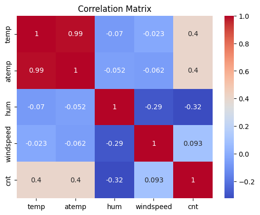

# Bike Sharing Demand Analysis

Exploratory data analysis and regression in Python of 17,379 hours of bike-share rentals, asking how weather and season change demand. Built for the Programming with Data module of my University of London BSc Computer Science.

**[Open the notebook](bike_sharing_analysis.ipynb)**



## What the notebook covers

1. **Loading and cleaning** with pandas: data types, missing values, duplicates, a date-time conversion, sanity checks for negative values, and box plots for outliers.
2. **Visual exploration** with Matplotlib: rentals against temperature and wind speed, rentals over time, by season, and their distribution.
3. **Correlation:** Pearson coefficients between rentals and temperature (0.40), humidity (−0.32) and wind speed (0.09), plus a correlation heatmap with Seaborn.
4. **Polynomial regression** of rentals on wind speed, to look past the linear correlation.
5. **Feature engineering:** weather-condition categories and a temperature × humidity interaction term.
6. **Models** with scikit-learn on humidity, temperature and wind speed, using an 80/20 train/test split:

| Model | MAE | R² |
| --- | --- | --- |
| Elastic Net (α = 0.5, L1 ratio 0.5) | 134.6 | 0.06 |
| Support vector regression (linear kernel) | 111.3 | 0.20 |

7. **Ethical considerations** and a conclusion.

## Run it

```bash
pip install -r requirements.txt
jupyter notebook bike_sharing_analysis.ipynb
```

## Data

`hour.csv` is the hourly file of the [Bike Sharing Dataset](https://archive.ics.uci.edu/dataset/275/bike+sharing+dataset) (Capital Bikeshare, Washington D.C., 2011–2012) from the UCI Machine Learning Repository, used under [CC BY 4.0](https://creativecommons.org/licenses/by/4.0/): Fanaee-T, H. (2013). Bike Sharing [Dataset]. UCI Machine Learning Repository. <https://doi.org/10.24432/C5W894>
